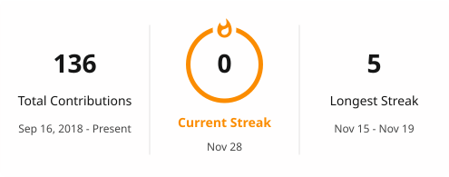

# Daniel Sosa
### Software Developer | Computer Engineering | IT Educator

Software developer and educator passionate about building technology solutions and sharing knowledge.

My experience combines software development, university teaching, database design, and web and mobile application development. I am particularly interested in backend architecture, artificial intelligence, and the integration of technology into education.

---

## Professional Profile

- Software development and application architecture.
- Backend development and RESTful API design.
- Web and mobile application development.
- Database design, management, and optimization.
- University teaching and technical education.
- Technology integration and applied artificial intelligence.

## Technical Skills

**Programming Languages**

**Web Development**

**Mobile Development**

**Databases and Cloud**

**Tools and Platforms**

---

## Featured Projects

### SosaStore

E-commerce web application focused on product management and online shopping functionality.

**Technologies:** Next.js, TypeScript, React, Supabase.

[View repository](https://github.com/93Cast/SosaStore)

### Inventory Management System

Application for inventory administration and product control.

**Technologies:** Java, Spring Boot, MySQL.

[View repository](https://github.com/93Cast/SistemaInventario)

### CRUD Spring Example

Educational project demonstrating CRUD operations and web application development using Spring.

**Technologies:** Java, Spring Boot, Thymeleaf, MySQL.

[View repository](https://github.com/93Cast/CRUDSpringExample)

### PokeAPI

Web application that consumes Pokémon information through an external REST API.

**Technologies:** JavaScript, REST API.

[View repository](https://github.com/93Cast/PokeApi)

---

## Achievements

- **2nd Place – EUREKA 2025:** Engineering Category.
- **4th Place – ESEN Programming Competition.**
- Experience in technical education and software development training.
- University teaching in systems analysis, design, and databases.

---

## Teaching and Technology

I am interested in the intersection of software development and education. My work as an educator allows me to combine technical knowledge with practical learning experiences.

I am particularly interested in exploring artificial intelligence, emerging technologies, and innovative approaches to software development and technical education.

---

## GitHub Statistics

  

  

  

---

## Connect

  
  

  <a href="https://github.com/93Cast?tab=repositories">Explore all my repositories</a>

  Building software. Sharing knowledge. Creating impact through technology.

